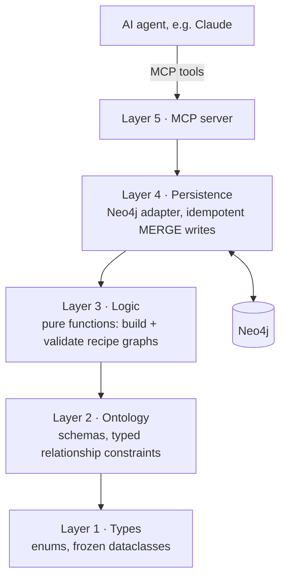

# FP_core

**A typed accounting knowledge graph that lets AI agents do bookkeeping without making things up.**

## Why this exists

Ask an LLM to turn a payroll export into journal entries and it will improvise: account names that don't exist, entries that don't balance, different answers on different runs. Accountants can't rely on that.

FP_core gives the agent a **typed accounting graph and pure validation rules** to work from. Accounts, entities, dimensions and transactions live in Neo4j with typed relationships. Reusable **recipes** describe how a source file (timeclock entries, invoices, bank feeds) maps onto that graph. The agent reaches all of it through an **MCP server**. Every journal entry is checked: **debits must equal credits** (a hard block), and softer issues come back as warnings for a person to review. The system guides but doesn't block.

I built this as a controller who has spent years writing those mappings and checks by hand. FP_core turns them into code an agent can follow.

## What it looks like

A payroll recipe stored in the graph turns a payroll file into balanced journal entries. From the eval fixtures (`evals/fixtures/source_data/`, synthetic data):

**Input:** `payroll_5emp_jan.csv` (5 employees)

```csv
employee_id,pay_date,gross_pay,tax_withheld,net_pay,department
E001,2026-01-31,5500.00,1375.00,4125.00,Engineering
E002,2026-01-31,4200.00,1050.00,3150.00,Marketing
E003,2026-01-31,6800.00,1700.00,5100.00,Engineering
E004,2026-01-31,3500.00,875.00,2625.00,Sales
E005,2026-01-31,4500.00,1125.00,3375.00,Operations
```

**Expected output:** `sample_journal_output.csv` (three balanced entries: salary expense, tax withholding, net pay)

```csv
journal_number,journal_date,account_code,debit_amount,credit_amount,memo
PY-202601-0001,2026-01-31,6100,24500.00,0.00,Salary expense - January 2026
PY-202601-0001,2026-01-31,2100,0.00,24500.00,Salary expense - January 2026
PY-202601-0002,2026-01-31,2100,6125.00,0.00,Tax withholding - January 2026
PY-202601-0002,2026-01-31,2200,0.00,6125.00,Tax withholding - January 2026
PY-202601-0003,2026-01-31,2100,18375.00,0.00,Net pay disbursement - January 2026
PY-202601-0003,2026-01-31,1010,0.00,18375.00,Net pay disbursement - January 2026
```

Gross pay ($24,500) = tax withheld ($6,125) + net pay ($18,375), and debits equal credits ($49,000) across the batch.

## Architecture



| | |
|---|---|
| **Graph** | 19 node types (7 core accounting, 12 recipe/pipeline), 26 typed relationship types |
| **Validation** | Pure functions returning `ValidationResult` (errors + warnings); no exceptions, no side effects |
| **Persistence** | MERGE-based writes: reruns never duplicate data |
| **MCP tools** | 7: `list_available`, `load_recipe`, `load_format`, `get_processing_instructions`, `build_and_save_pipeline`, `build_output`, `validate_entries` |
| **Tests** | 428 across domain, persistence and MCP server (9 Neo4j integration tests skip without a database) |
| **Stack** | Python 3.12 · Neo4j 5 · MCP Python SDK (FastMCP) · pytest · ruff |

The domain has two sides:

- **Core accounting** (7 node types): Account, Transaction, TransactionLine, Entity, AnalyticalDimension, AllocationRule, DataSource
- **Recipe/pipeline** (12 node types): SourceSchema, Column, Measure, Condition, AccountSlot, MappingRule, AccountingRecipe, OutputFormat, OutputColumn, Reference, ValidationRule, EntryStructure

### Key graph edges

```
Entity --HAS_ACCOUNT--> Account
Transaction --HAS_LINE--> TransactionLine --POSTS_TO--> Account
Account --HAS_DIMENSION--> AnalyticalDimension
AccountingRecipe --HAS_SCHEMA--> SourceSchema --HAS_COLUMN--> Column
AccountingRecipe --HAS_SLOT--> AccountSlot --MAPPED_TO--> Account
MappingRule --MAPS_COLUMN--> Column
```

## Design decisions

- **A graph, not tables.** Accounting is relationships: an entry posts to an account that belongs to an entity and carries dimensions. A graph makes those connections, and the rules about which ones are allowed, explicit and queryable.
- **Immutable types and pure functions.** All domain types are frozen dataclasses, and validation never mutates state or throws. That makes the logic easy to test, compose and trust: the software version of a reconciliation you can re-run any time.
- **Guide, don't block.** Hard errors stop structural problems such as unbalanced entries. Everything else is a warning, because accounting needs professional judgment and a tool that refuses every edge case won't be used.
- **MCP as the interface.** Any MCP-capable agent can use the graph without custom integration code.
- **Secure by default.** The HTTP server refuses to start without OAuth configured (fails closed), and graph queries are protected against Cypher injection.

## Deployment

The MCP server runs on **Railway** (`railway.toml`: Railpack build, `python -m mcp_server`) over Streamable HTTP. Requests need an OAuth bearer token issued by **Auth0**; `mcp_server/auth.py` checks the token's issuer and audience. If `AUTH0_DOMAIN` or `AUTH0_AUDIENCE` is missing, the server refuses to start rather than run unauthenticated.

Locally, the server runs over STDIO with no auth, as shown in the Quickstart below.

## Quickstart

```bash
git clone https://github.com/brianhuebner/FP_core.git && cd FP_core
python3.12 -m venv .venv
source .venv/bin/activate
pip install -e ".[dev]"

# Lint and test
ruff check .
pytest
# Expected: 419 passed, 9 skipped
# (the 9 Neo4j integration tests skip unless NEO4J_URI and NEO4J_PASSWORD are set)

# Integration tests (requires a running Neo4j)
NEO4J_URI=bolt://localhost:7687 NEO4J_PASSWORD=your_password pytest tests/persistence/test_operations.py

# Run the MCP server locally (STDIO)
python -m mcp_server
```

## Agent evals

`evals/` holds scenario-based evals for an agent driving the MCP tools: five scenarios (build a pipeline, process data, build an output format, process with a format, group-by/split-by measures), each with a setup script and a validator. Run one with `./evals/run_eval.sh <n>`.

## Directory structure

```
FP_core/
  domain/            Layers 1–3: types, ontology + validation, pure logic (public API in __init__.py)
  persistence/       Layer 4: merge keys, serializers, deserializers, Neo4j connection, operations
  mcp_server/        Layer 5: FastMCP server, auth, builders, summarizers, tools, prompts, resources
  tests/             domain/, persistence/ (pure + Neo4j integration), mcp_server/
  evals/             agent eval scenarios, setup scripts, validators, fixtures
  specs/             feature and workflow specs
  docs/              architecture, user flow, roadmap, agent skill guide
  railway.toml       Railway deployment config
  requirements.txt   runtime dependencies (used by the Railway build)
  pyproject.toml     package metadata, dependencies, ruff + pytest config
  LICENSE            MIT
  CLAUDE.md          Claude Code development guide (file map, canonical counts, extension patterns)
```

Each package has its own `CLAUDE.md` with layer-specific architecture and data contracts.

## Key invariants

- **Double-entry balance:** every transaction's debit lines must equal its credit lines. Enforced by `validate_transaction_balance` as a hard block.
- **Immutable domain types:** all dataclasses use `frozen=True`. Domain objects are never mutated after creation.
- **Pure validation:** validators are pure functions returning `ValidationResult` with `is_valid`, `errors` and `warnings`. No exceptions for validation failures, no side effects.
- **Typed constraints:** `RELATIONSHIP_CONSTRAINTS` and `RECIPE_RELATIONSHIP_CONSTRAINTS` define exactly which (source, target) node type pairs are allowed for each relationship type.

## Design documents

- `docs/mcp_architecture.md`: MCP server architecture and design decisions
- `docs/user_flow.md`: end-to-end user flow
- `docs/vision_and_roadmap.md`: project vision and roadmap
- `docs/fp_core_skill.md`: guided workflows for AI agents using the MCP tools

## License

[MIT](LICENSE) © 2026 Brian Huebner
